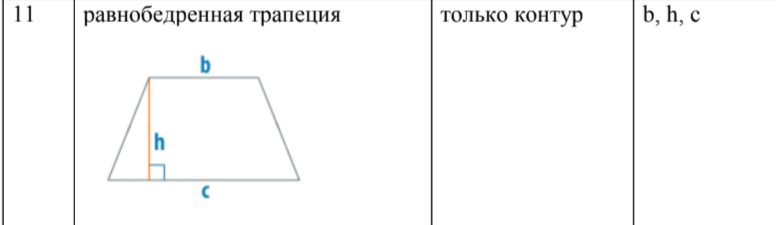
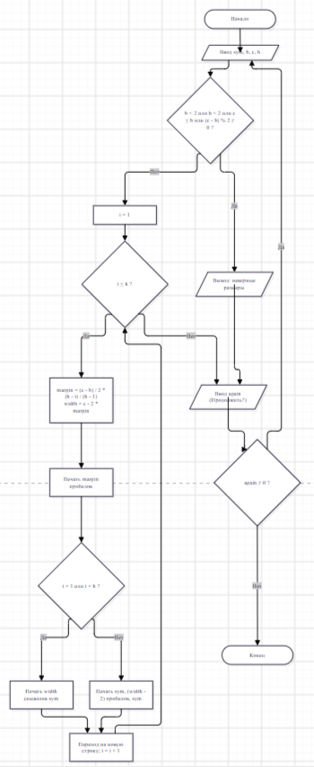

## Домашнее задание к лабораторной 6

### Вариант 11

#define _CRT_SECURE_NO_WARNINGS

#include <stdio.h>

#include <locale.h>

int main()
{
    setlocale(LC_ALL, "Russian");

    char sym;            // символ, из которого строим фигуру
    int b, c, h;         // размеры
    int i, j;            // счётчики циклов
    int margin, width;   // отступ слева и ширина текущей строки
    int again;           // для повтора программы

    do
    {
        printf("Введите символ из которого будет строиться фигура: ");
        scanf(" %c", &sym);
        printf("Введите верхнее основание b: ");
        scanf("%d", &b);
        printf("Введите нижнее основание c: ");
        scanf("%d", &c);
        printf("Введите высоту h: ");
        scanf("%d", &h);

        if (b < 2 || h < 2 || c <= b || (c - b) % 2 != 0)
        {
            printf("Нужно: b >= 2, h >= 2, c > b и разность c - b чётная\n");
        }
        else
        {
            printf("Равнобедренная трапеция (только контур):\n\n");

            for (i = 1; i <= h; i++)
            {
                // отступ слева: сверху самый большой, внизу 0
                margin = (c - b) / 2 * (h - i) / (h - 1);
                width = c - 2 * margin;

                // отступ
                for (j = 1; j <= margin; j++)
                    printf(" ");

                if (i == 1 || i == h)
                {
                    // верхнее и нижнее основание - сплошные
                    for (j = 1; j <= width; j++)
                        printf("%c", sym);
                }
                else
                {
                    // боковые стороны - по одному символу слева и справа
                    printf("%c", sym);
                    for (j = 1; j <= width - 2; j++)
                        printf(" ");
                    printf("%c", sym);
                }
                printf("\n");
            }
        }

        printf("\nПродолжить ? (Да - введите любое число, Нет - введите 0): ");
        scanf("%d", &again);
    } while (again != 0);

    return 0;
}

### Вывод
#### Я научилась использовать цикл внутри цикла: внешний цикл отвечает за строки, внутренний за символы в строке. С помощью этого я вывела таблицу Пифагора, её треугольник и фигуру из символов. Я написала программу разбора числа на цифры и добавила повтор работы через `do-while`, который заканчивается по желанию пользователя. Вложенные циклы подходят для таблиц и фигур, а `do-while` удобен, когда тело цикла должно выполниться хотя бы один раз.